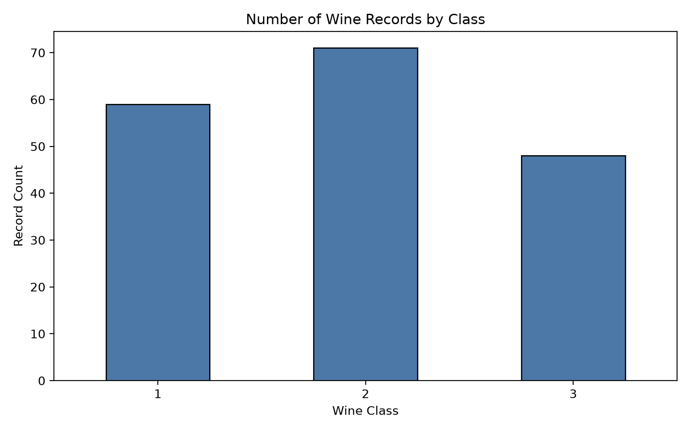
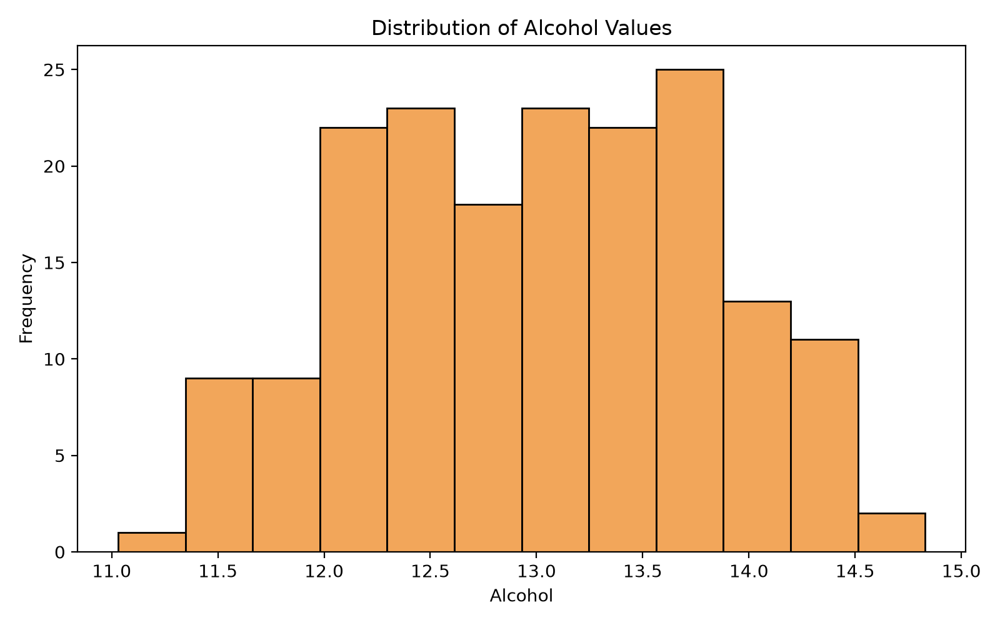

# Wine Dataset Exploratory Data Analysis (EDA)

**Student Name:** Aditya Kumar  
**Admission Number:** 2026B01011203  
**Roll Number:** 2026B01011203  
**Project Title:** Wine Dataset Exploratory Data Analysis (EDA)

## Objective
To perform basic descriptive exploratory data analysis of the UCI Wine Recognition Dataset without creating a machine-learning model.

## Dataset Details
- Source: [UCI Wine Recognition Dataset](https://archive.ics.uci.edu/dataset/109/wine)
- Loaded source shape: **178 rows x 14 columns** (plus the generated 1-based `Record_ID`)
- Each record has the original class label (1, 2, or 3) and 13 measured attributes.
- Original `wine.data` and `wine.names` files remain unchanged.

## Methodology and Tools
The analysis uses Python, NumPy, Pandas, and Matplotlib. It loads the headerless data with the exact required column order, checks data quality, and computes descriptive summaries and two charts.

## 1. Records by Class
| Class | Count |
|---:|---:|
| 1 | 59 |
| 2 | 71 |
| 3 | 48 |

## 2. Alcohol Statistics
| Statistic | Value |
|---|---:|
| Mean | 13.0006 |
| Median | 13.0500 |
| Minimum | 11.0300 |
| Maximum | 14.8300 |

## 3. Highest Average Alcohol and Magnesium
- Highest average **Alcohol**: Class 1 (13.7447)
- Highest average **Magnesium**: Class 1 (106.3390)

## 4. Ten Highest Color Intensity Records
| Record_ID | Class | Color intensity |
|---:|---:|---:|
| 159 | 3 | 13.0000 |
| 160 | 3 | 11.7500 |
| 152 | 3 | 10.8000 |
| 167 | 3 | 10.6800 |
| 154 | 3 | 10.5200 |
| 168 | 3 | 10.2600 |
| 176 | 3 | 10.2000 |
| 172 | 3 | 9.9000 |
| 173 | 3 | 9.7000 |
| 165 | 3 | 9.5800 |

## 5. Missing Values and Duplicate Rows
### Missing values per column
| Column | Missing count |
|---|---:|
| Class | 0 |
| Alcohol | 0 |
| Malic acid | 0 |
| Ash | 0 |
| Alcalinity of ash | 0 |
| Magnesium | 0 |
| Total phenols | 0 |
| Flavanoids | 0 |
| Nonflavanoid phenols | 0 |
| Proanthocyanins | 0 |
| Color intensity | 0 |
| Hue | 0 |
| OD280/OD315 of diluted wines | 0 |
| Proline | 0 |

- Duplicate rows: **0**
- No duplicate-based cleaning was applied, and no values were imputed.

## 6. Average Alcohol, Malic Acid, and Color Intensity by Class
| Class | Average Alcohol | Average Malic acid | Average Color intensity |
|---:|---:|---:|---:|
| 1 | 13.7447 | 2.0107 | 5.5283 |
| 2 | 12.2787 | 1.9327 | 3.0866 |
| 3 | 13.1538 | 3.3337 | 7.3962 |

**Brief interpretation:** The average values differ across the three classes. These differences describe the observed groups and do not establish causation.

## Charts
- 
- 

## Three Observations
1. Class 2 has the largest number of records, with 71 records.
2. Alcohol ranges from 11.0300 to 14.8300, with a mean of 13.0006.
3. Class 1 has the highest average Alcohol, while Class 1 has the highest average Magnesium.

## Conclusion
This was basic descriptive EDA only. No machine learning, classification, prediction, regression, or clustering was performed.
